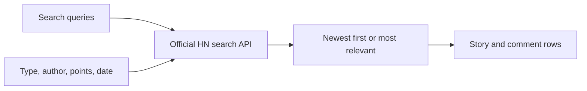

# Hacker News Scraper: Search Stories, Comments and Show HN

[](https://apify.com/Turboextract/hacker-news-search)
[](LICENSE)
[](#pricing)

**Search Hacker News stories, comments, Show HN, Ask HN, jobs and the live front page by keyword, author, points, comment count and date.** Each row has the title, link, domain, points, comments, author, text and HN link. Uses the official Hacker News search API, so runs are fast and there is no login.

In one test, the actor returned 250 recent stories about web scraping, 19 comments mentioning a product from the past 60 days, and the 30 most-voted Show HN scraping launches.

**Try it now →** [apify.com/Turboextract/hacker-news-search](https://apify.com/Turboextract/hacker-news-search)

---

## Why this exists

- Hacker News search shows results one page at a time, with no export.
- Mentions of a product often sit deep in comment threads.
- Social listening tools rarely cover Hacker News well, and charge monthly.
- Tracking Show HN launches by hand means checking the site every day.

---

## Who this is for

- **Founders and marketers** tracking mentions of their product and competitors
- **Developer relations teams** finding discussions to join
- **Investors and analysts** spotting launches with traction on Show HN
- **Researchers** studying developer sentiment and trends
- **AI and data teams** collecting high-quality technical discussion

---

## What you get

```json
{
  "type": "story",
  "id": 7066479,
  "title": "Show HN: Kimono – Never write a web scraper again",
  "url": "http://kimonify.kimonolabs.com/...",
  "domain": "kimonify.kimonolabs.com",
  "hnUrl": "https://news.ycombinator.com/item?id=7066479",
  "author": "username",
  "points": 717,
  "comments": 230,
  "createdAt": "2014-01-15T21:59:50Z",
  "text": null,
  "query": "scraper"
}
```

Comment rows also carry `storyId`, `storyTitle`, `storyUrl` and `parentId`.

---

## How it works



---

## Quick start

1. Click **Try for free**.
2. Add **Search queries**, like `web scraping` or your product name.
3. Pick a **Type**: stories, comments, Show HN, Ask HN, jobs, polls or the front page.
4. Optional: set **Minimum points**, **Authors** or **Posted within (days)**.
5. Click **Start**, then export to CSV, JSON or Google Sheets.

### API

```bash
curl -X POST "https://api.apify.com/v2/acts/Turboextract~hacker-news-search/run-sync-get-dataset-items?token=YOUR_TOKEN" \
  -H "Content-Type: application/json" \
  -d '{
    "searchQueries": ["your product"],
    "contentType": "comment",
    "postedWithinDays": 1
  }'
```

### Python

```python
from apify_client import ApifyClient

client = ApifyClient("YOUR_TOKEN")
run = client.actor("Turboextract/hacker-news-search").call(run_input={
    "searchQueries": ["open source"],
    "contentType": "show_hn",
    "minPoints": 100,
    "sort": "relevance",
})
for s in client.dataset(run["defaultDatasetId"]).iterate_items():
    print(s["points"], s["title"], s["hnUrl"])
```

---

## Input fields

| Field | Default | What it does |
|---|---|---|
| `searchQueries` | – | Keywords. Empty lists the newest items of the type |
| `contentType` | story | Stories, comments, Show HN, Ask HN, front page, jobs or polls |
| `sort` | date | Newest first or most relevant |
| `authors` | – | Only these HN usernames |
| `minPoints` | 0 | Stories only |
| `minComments` | 0 | Stories only |
| `postedWithinDays` | 0 (all) | Only recent items |
| `maxResultsPerQuery` | 100 | Per query |
| `maxResults` | 500 | Total cap per run |

---

## Pricing

**$0.003 per story or comment delivered.** 1,000 items cost $3.

| Option | 1,000 items |
|---|---|
| **Hacker News Scraper** | **$3**, stories, comments and front page in one actor |
| Other Hacker News actors on Apify | $0.20 to $2.35 |
| Social listening tools | $50+ a month |

---

## Common use cases

- **Mention alerts**: your product and competitors in comments, every hour
- **Launch research**: top Show HN posts in your category
- **Content ideas**: Ask HN questions about your topic
- **Trend tracking**: story counts and points for a keyword over time
- **Community outreach**: authors who comment often on your topic
- **Hiring signals**: companies whose posts get traction before they raise

---

## Tips for best results

- Newest-first search can page past 1,000 results, so large backfills work.
- Use quotes for exact phrases, like `"web scraping"`.
- Dedupe on `id` across scheduled runs.
- For HN "Who is hiring" job posts, use [HN Hiring Leads](https://apify.com/Turboextract/hn-hiring-leads).

---

## Pairs well with

- [HN Hiring Leads](https://apify.com/Turboextract/hn-hiring-leads): companies hiring in the monthly HN threads
- [GitHub Trending Repos](https://apify.com/Turboextract/github-trending-repos): the projects HN is talking about
- [Google News Scraper](https://apify.com/Turboextract/google-news-feed): press coverage of the same topics

---

## FAQ

**Do I need a Hacker News account?** No. The actor uses the official public search API.

**How far back does it go?** To the start of Hacker News in 2007.

**Does it return full comment threads?** It returns each matching comment with its story and parent IDs. Search by type `comment` with a query to find the ones you need.

**How fast is it?** A few hundred items take seconds.

**Is it legal?** It uses Hacker News' public search API for public posts.

---

## SEO keywords

Hacker News scraper, Hacker News API, HN search API, scrape Hacker News, Show HN scraper, Hacker News comments export, Hacker News mention alerts, Algolia HN API, Y Combinator news scraper, developer community monitoring

---

## Support

- Actor page: https://apify.com/Turboextract/hacker-news-search
- Issues and questions: open an issue in this repo
- Community Discord: https://discord.gg/8SrXSCpvgj

Built and maintained by [Turboextract](https://apify.com/Turboextract) on the Apify platform.

---

## License

The documentation and examples in this repository are MIT licensed. The actor itself runs on the Apify platform.
